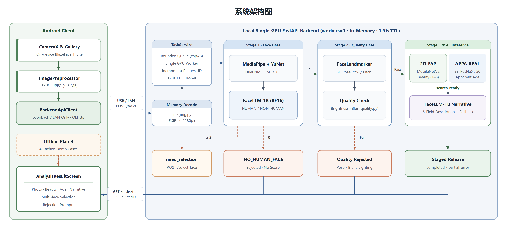

# 随心一拍 —— 本地深度学习人脸颜值评分与多维面部特征分析系统

> **手机端轻量实时预览 + 本地单 GPU 推理服务 + 离线应急演示（Plan B）**

本项目是吉林大学 Android 软件开发课程期末大作业。

整体由 **Android 客户端（Kotlin / Jetpack Compose / CameraX / MediaPipe）**、**本地 FastAPI GPU 推理后端（FaceLLM-1B + 2D-FAP + APPA-REAL + 姿态/画质门禁）** 与 **可复现训练工程** 组成。所有上传图像仅在本地设备内存中处理并在 `120` 秒后自动销毁，不上传任何公网云端服务器。

---

## 系统架构



> 架构可编辑矢量源文件见 [`docs/assets/architecture.svg`](docs/assets/architecture.svg)。v1.1 版本已精简并移除旧版 478 点像素平面几何测量、分性别统计及 Grad-CAM / 局部模糊敏感性模块，聚焦端云协同的主链路分析体验。

---

## 核心特性

- **端云协同与隐私闭环**
  - 手机端使用端侧离线 `MediaPipe BlazeFace` 进行低延迟人脸框与关键点预览；
  - 推理请求限制原始二进制流（`<= 8 MB`），后端纯内存解码并设置 `120s` TTL 自动清理（支持客户端主动 `DELETE` 立即销毁），客户端拦截公网 URL 与 HTTP 重定向。
- **双检测器 + VLM 候选级门禁 + 画质校验**
  - 结合 `MediaPipe` 与 `OpenCV YuNet` 双检测器做候选关联，再由常驻 `Idiap/FaceLLM-1B` 对每个候选框逐一判别 `HUMAN / NON_HUMAN / UNKNOWN`；
  - 狗、猫、动漫、玩偶等非人脸统一拦截为 `NO_HUMAN_FACE`（“未识别到人脸”）且绝不出分；人宠同框自动过滤非人脸；多人同框支持交互式点选目标人脸（`need_selection`）；
  - 通过 `FaceLandmarker` 3D 姿态矩阵与灰度亮度 / Laplacian 清晰度检验，对偏转过大、过暗过曝或失焦照片给出具体重拍引导。
- **颜值评分、表观年龄与自然语言面容描述**
  - **颜值评分（`2D-FAP` / MobileNetV2）**：1–5 分制期望分及五档概率分布；在 `SCUT-FBP5500` 官方五折交叉验证上取得均值 `PC = 0.9135 ± 0.0029`、`MAE = 0.2152 ± 0.0037`；
  - **表观年龄（`APPA-REAL` / SE-ResNeXt-50）**：基于官方预训练 101 类期望年龄估计；
  - **中文可见外观描述（`FaceLLM-1B`）**：提取眉、眼、鼻、嘴、脸部轮廓与可见表情六字段观察并合成一段式自然语言面容描述（超时自动走受控回退，保留数值结果）。
- **零网络离线演示（Plan B）**
  - App 内置 4 组由真实后端推理导出的离线缓存样例（含正常正脸全量分析与非人脸/失焦拦截样例），无后端时也可一键体验完整界面流程。

---

## 快速启动后端推理

仓库根目录提供了两个直接启动后端推理服务的脚本（Windows PowerShell）：

| 脚本 | 适用场景 | 监听地址 |
|---|---|---|
| [`run_usb_mode.ps1`](run_usb_mode.ps1) | **USB 有线调试（推荐首选）**，配合 `adb reverse` 本地回环通信 | `http://127.0.0.1:8000` |
| [`run_hotspot_mode.ps1`](run_hotspot_mode.ps1) | **手机热点 / 局域网无线连接**，手机端填写电脑局域网 IP | `http://0.0.0.0:8000` |

在仓库根目录直接运行：

```powershell
# 方式 A：USB 有线模式（推荐）
.\run_usb_mode.ps1

# 方式 B：热点 / 局域网模式
.\run_hotspot_mode.ps1
```

> 可选参数：可通过 `-Python <路径>` 显式指定 Python 解释器（例如 `.\run_usb_mode.ps1 -Python .\.venv\Scripts\python.exe`）；未传参时脚本会自动依次查找 `.venv`、已激活虚拟环境或系统 `PATH` 中已安装依赖的 `python`。

启动后会在单 GPU 线程内加载并预热全部模型（约 15–30 秒）。在浏览器或终端访问健康检查接口，确认 `warmed_up` 为 `true` 即可开始使用：

```powershell
Invoke-RestMethod http://127.0.0.1:8000/api/v1/health
```

---

## 环境配置与使用指南

### 1. 硬件与系统要求

- **后端推理主机**：Windows 10/11，推荐配备支持 CUDA 的 NVIDIA GPU（实测 `RTX 4060 Laptop 8 GB VRAM` 可流畅常驻全部模型，峰值显存约 `2.3 GiB`），Python `3.10`–`3.13`。
- **Android 手机**：Android 8.0（API 26）及以上真机（支持 CameraX 与本地照片选择）。

### 2. 安装后端依赖与模型权重

```powershell
# 1) 创建并激活虚拟环境（示例）
python -m venv backend\.venv
.\backend\.venv\Scripts\Activate.ps1

# 2) 安装 Python 依赖
pip install -r backend\requirements.txt

# 3) 下载公开模型权重与预热样本（MediaPipe、YuNet、Idiap/FaceLLM-1B、APPA-REAL）
# 若所处网络环境需要代理，请先设置 $env:HTTPS_PROXY / $env:HTTP_PROXY
python backend\scripts\download_weights.py
python backend\scripts\prepare_age.py
```

**关于 2D-FAP 颜值权重：**
- 上述公开下载脚本会自动备齐 `FaceLLM-1B`、MediaPipe、YuNet 与 `APPA-REAL` 官方年龄权重；
- **推荐直接从本仓库 [Releases (v1.1)](https://github.com/gengyan152/suixin-facial-analysis/releases/tag/v1.1) 下载已训练好的 `2dfap_fold1_state_dict.pt`**，放入 `backend/weights/` 即可开箱获得正式颜值评分；
- 若未放置该权重文件，后端仍可正常启动，并在健康检查和界面中诚实标示 `weights_status = "untrained_init"`（`weights_ready = false`）；
- 如需从头复现训练，请参考 [training/README.md](training/README.md) 完成 `SCUT-FBP5500` 五折训练后导出至 `backend/weights/`。

### 3. 安装或构建 Android 客户端

- **方式一：直接安装 Release APK（推荐）**
  - 从本仓库 [Releases (v1.1)](https://github.com/gengyan152/suixin-facial-analysis/releases/tag/v1.1) 下载 `suixin-1.1.apk`，通过 `adb install -r suixin-1.1.apk` 或直接在手机上安装。
- **方式二：从源码构建**
  - 使用 Android Studio 打开 `android-app/` 目录编译运行，或在仓库根目录执行：
    ```powershell
    .\android-app\build_apk.ps1
    ```
  - 编译产物位于 `android-app/app/build/outputs/apk/debug/app-debug.apk`。

### 4. 连接手机与后端

1. **USB 有线模式（推荐）**
   - 电脑端运行 `.\run_usb_mode.ps1`；
   - 手机开启 USB 调试并连接电脑，在另一个终端执行端口转发：
     ```powershell
     adb reverse tcp:8000 tcp:8000
     ```
   - 打开「随心一拍」App（默认地址即为 `http://127.0.0.1:8000`），点击右上角设置图标可一键测试连通性，随后即可拍照或从相册选图分析。
2. **热点 / 局域网无线模式**
   - 手机开启个人热点供电脑连接（或处于同一局域网），电脑端运行 `.\run_hotspot_mode.ps1`（注意在 Windows 防火墙放行 `8000` 端口）；
   - 在电脑端执行 `ipconfig` 查看无线/热点网卡 IPv4 地址（常见如 `192.168.137.1` 或 `192.168.x.x`）；
   - 在 App 右上角 **连接设置** 中填写 `http://<电脑IPv4地址>:8000`，点击测试连通性并保存。
3. **离线应急演示（Plan B）**
   - 无需连接后端，点击 App 首页右上角 **示例图标**（或断线提示卡中的 **离线演示入口**），即可体验内置的 4 组离线分析样例。

---

## 仓库目录结构

```text
.
├── run_usb_mode.ps1          # [入口] USB 回环模式启动后端推理（127.0.0.1:8000）
├── run_hotspot_mode.ps1      # [入口] 热点/局域网模式启动后端推理（0.0.0.0:8000）
├── android-app/              # Android 客户端（Kotlin + Compose + CameraX + TFLite）
│   ├── build_apk.ps1         # 兼容中文路径的 Gradle 构建/测试脚本
│   └── README.md             # 客户端界面设计与构建说明
├── backend/                  # FastAPI 单 GPU 推理后端
│   ├── app/                  # 核心服务（门禁、质量校验、数值推理、FaceLLM）
│   ├── scripts/              # 权重下载、年龄权重解包、启动辅助与冒烟脚本
│   ├── tests/                # 契约单测与真实 CUDA 集成测试
│   ├── requirements.txt      # 后端运行依赖
│   └── README.md             # 后端架构与接口详情
├── training/                 # 模型复现训练与 5 折交叉验证脚本
│   ├── vendor/               # 上游模型参考源码快照（2D-FAP / age-estimation-pytorch）
│   └── README.md             # 数据集准备、训练命令与实验指标记录
├── docs/                     # 技术文档与架构图
│   ├── assets/architecture.* # v1.1 系统总体架构图（SVG 源文件 + PNG）
│   ├── API_CONTRACT.md       # 前后端接口与数据结构契约 v1.1
│   └── TRAINING_ASSESSMENT.md# RTX 4060 实测吞吐量与五折正式训练报告
└── AGENTS.md                 # 仓库协作开发精简指引
```

---

## 测试与开发验证

- **后端单元测试（无需下载真实大模型）**：
  ```powershell
  cd backend
  pytest -q
  ```
- **后端全量集成测试（需已下载权重与 CUDA GPU）**：
  ```powershell
  cd backend
  pytest -q --live
  ```
- **Android 单元测试**：
  ```powershell
  .\android-app\build_apk.ps1 -Tasks @(":app:testDebugUnitTest")
  ```

---

## 隐私与伦理声明

1. 本系统提供的颜值评分（基于 `SCUT-FBP5500` 数据集标注者的主观统计偏好）与表观年龄（基于 `APPA-REAL`）**仅作为 Android 软件开发课程设计展示与技术实验参考**，不代表客观美学标准或个人价值评判。
2. 系统不进行任何疾病诊断、性格命运推断或性取向预测；对于局部遮挡或无法观察的五官特征，文字生成模块严格输出“无法判断”。
3. 上传照片仅在本地设备内存中短暂驻留并在 `120` 秒 TTL 到期或手动删除后销毁，不写入磁盘数据库，亦不向第三方公网服务发送图像数据。
